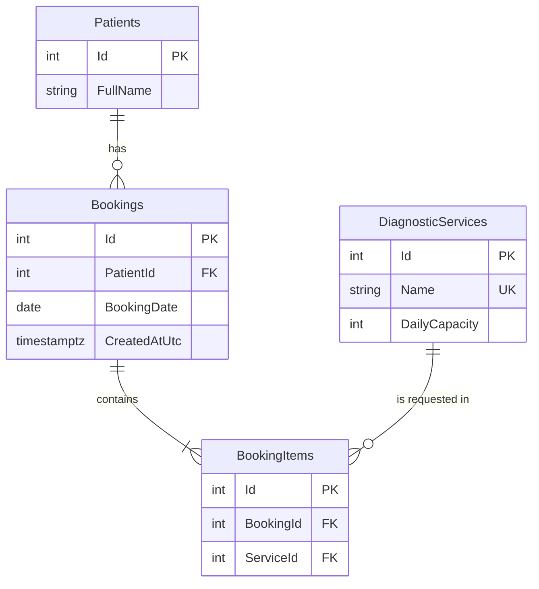
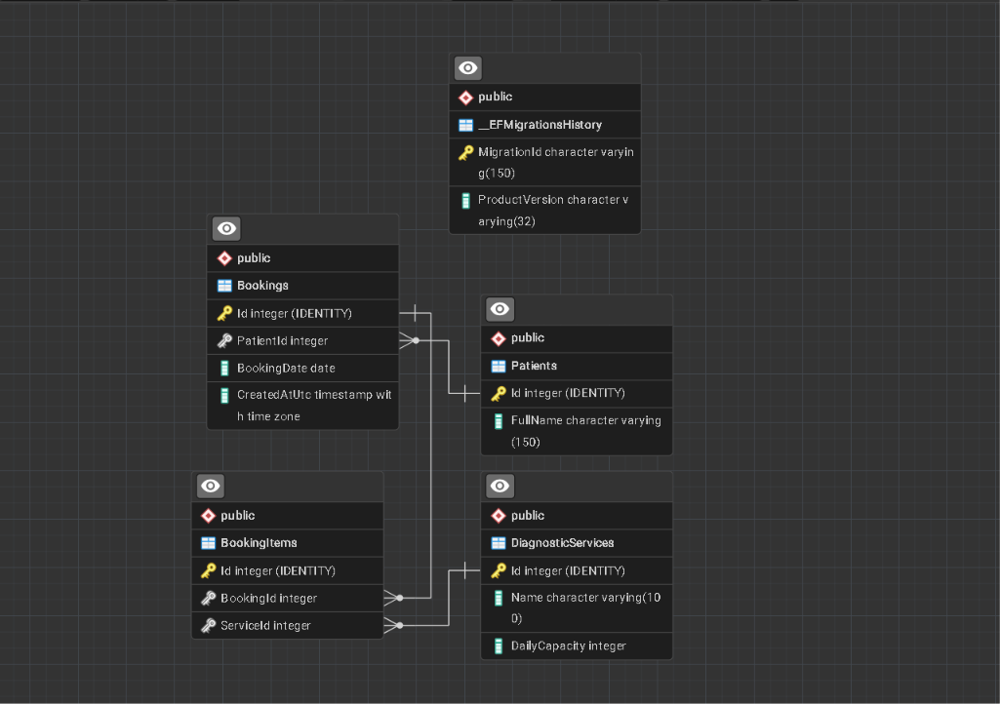

# Relational Design - CareFlow

Database: PostgreSQL, database name `CareFlow`. Schema is created by the EF Core migration `InitialCreate`.

## Entity relationship diagram

## Tables

| Table | Column | Key | Notes |
|---|---|---|---|
| Patients | Id | PK | Fictional seed data |
| Patients | FullName | | Required, max 150 |
| DiagnosticServices | Id | PK | |
| DiagnosticServices | Name | Unique | Required, max 100 |
| DiagnosticServices | DailyCapacity | | Check constraint: greater than 0 |
| Bookings | Id | PK | |
| Bookings | PatientId | FK to Patients.Id | Restrict delete (BR-01) |
| Bookings | BookingDate | Index | `date`; the day the services are booked for |
| Bookings | CreatedAtUtc | | `timestamptz` |
| BookingItems | Id | PK | One row per service in a booking |
| BookingItems | BookingId | FK to Bookings.Id | Cascade delete |
| BookingItems | ServiceId | FK to DiagnosticServices.Id | Restrict delete |

Additional constraint: **unique index on (BookingId, ServiceId)**, so the same service cannot appear twice in one booking (BR-06).

## Relationships

- One patient has many bookings (1 : N).
- One booking contains one to three booking items (1 : N). The 1 to 3 limit is enforced by `BookingService` (BR-02).
- One diagnostic service appears in many booking items (1 : N).
- `Bookings` and `DiagnosticServices` have a many-to-many relationship through `BookingItems`.

## Capacity design

No counter is stored. The number of slots used by a service on a date is the count of `BookingItems`
rows for that service whose booking has that `BookingDate`. Remaining capacity = `DailyCapacity` minus that count.
Because capacity is always derived from saved rows, it cannot drift out of sync with the bookings.

## ERD generated from the database (pgAdmin)

Primary keys (`Id`) and foreign keys (`Bookings.PatientId`, `BookingItems.BookingId`, `BookingItems.ServiceId`)
are shown with their relationship lines. `__EFMigrationsHistory` is an EF Core bookkeeping table and is not part of the design.
